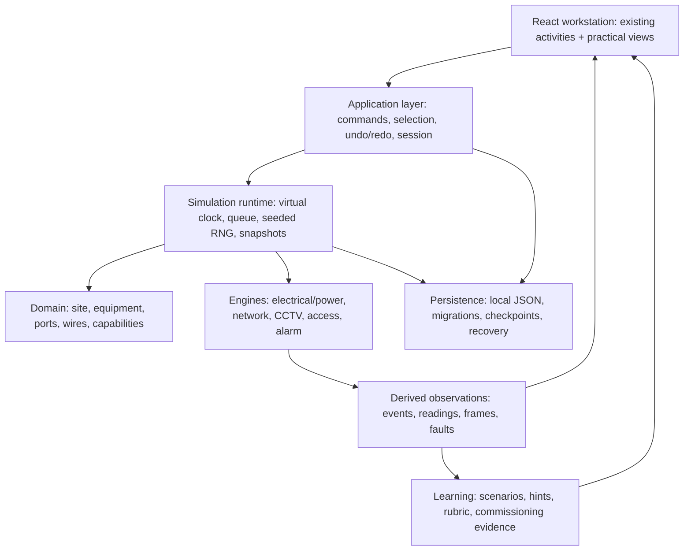

# SecurityLab — New Architecture
**Engineering direction and delivery charter | 24 November 2026 | Next development phase (V2)**

**Audience:** Senior Project Manager, Project Engineer and reviewers. This document directs future development; it is not evidence of implementation or release acceptance.

## 1. Mission and baseline

Build a free, offline-first virtual electronic-security installation lab that teaches learners to **design, select, wire, configure, operate, diagnose and commission** systems. Prioritize transferable practical skills, not decorative screens or a broad feature count. CCTV and IP networking form the first complete vertical slice; extend the same architecture to alarms, access control and backup power.

Start from current `main` (review baseline: `bd60b4c074cd6af3d49c78ac843b6b84f54d9514`, 23 November 2026). Refresh HEAD before work. Preserve the active React/TypeScript/Vite workstation, pure domain engines, 15 scenarios, existing tools, local files, recovery protections, accessibility and the five Design/Connect/Simulate/Troubleshoot/Assess activities. Do not rebuild from historical snapshots or confuse another simulator's source with this repository.

**Known gaps:** schematic rather than video-like camera views; limited network protocol model; incomplete physical terminal/wire-map interaction (a cable termination field already exists); single-door access controller with existing access schedules; simplified alarm/fire and power models; four guided lessons; bounded session replay; large entry bundle; outstanding physical and instructional acceptance. PR #21 reports 172 unit and 89 Chromium checks passed; the subsequent integration commit reports broader automated verification. These are recorded results, not newly independently executed tests.

**Constraints:** no mandatory backend, account, hosted project database, telemetry, subscription, external runtime dependency or real-device control. Keep user-owned JSON files and static PWA distribution. Simulation is not vendor firmware, standards conformance, a certified installation design or an accredited qualification. Owner approval is required for scope expansion outside this charter, license decisions, releases and deployment.

## 2. Target architecture — one model, multiple workspaces

Adopt a modular monolith with a framework-independent simulation core. Evolve existing modules incrementally; the following is a logical target, not a demand to rename every directory.

| Boundary | Responsibility / existing location |
|---|---|
| Presentation | `SecurityLab/frontend-react/src/`: floor plan, topology, physical equipment, device configuration, monitor/playback, instruments and learning views. Render snapshots; dispatch commands. |
| Application | Extract orchestration from `hooks/useWorkbench.ts` only where useful: typed commands, transactions, selection, validation, undo/redo and file lifecycle. |
| Domain | `SecurityLab/src/domain/`, `property/`: stable IDs, site/floor geometry in calibrated units, device capabilities, terminal and cable graphs, profiles. |
| Runtime | Proposed `SecurityLab/src/runtime/`: deterministic virtual time, scheduling, seeded randomness, event ordering, revisioned snapshots. Adapt existing engines rather than replace proven rules. |
| Engines and tools | `src/engine/`, `src/tools/`: testable calculations and state transitions; instruments consume actual modeled conditions, not invented readouts. |
| Learning | `src/scenarios/` plus assessment/field modules: versioned lessons, objectives, fault recipes, evidence and scoring. |
| Persistence | `src/persistence/`, `src/state/`: validated versioned files, migration, checkpoints, file conflicts, recovery. Service worker caches application/assets, not learner projects. |

**Engineering contracts**
- Separate authored project configuration, transient simulation runtime, derived observations and UI preferences. Use stable entity/port/terminal IDs; keep units explicit (m, V, W, Wh, Mbps, GB, seconds). Retain backwards-compatible legacy adapters.
- All workspaces edit the same canonical project through validated commands. A port configured in an equipment panel must immediately affect topology, power, stream, diagnostics and assessment. No duplicate independent device state or UI-only success flags.
- Use a virtual clock and deterministic event queue (time, stable sequence, source, type, payload). Resolve power, connectivity and device state in documented dependency order; bound feedback loops and report non-convergence. Same project, seed and command sequence must produce the same normalized observations.
- Runtime interface (proposed): load validated project; dispatch command with expected revision; start/pause/step/reset; query snapshot; subscribe to events; inject scenario faults. Reject stale commands/results. Do not persist wall-clock timers or unbounded event/frame buffers. Explicitly define checkpoint and replay semantics.
- Move expensive simulation/render preparation into a dedicated Web Worker when profiling justifies it; use versioned messages, cancellation, bounded queues and a lightweight fallback. Never make the 2D editor depend on WebGL.
- Preserve file-v1/v2 compatibility and validate/migrate in isolation before adoption. Keep checksums as corruption indicators, not authentication. Preserve conflict detection, read-back verification, unsaved-work warnings, export and recovery. Web Locks are same-origin coordination, not OS-wide locking.

## 3. Practical simulation requirements

| Capability | Target and evidence of completion |
|---|---|
| Physical installation | Original front/rear/terminal views, selectable interfaces, RJ45 pair mapping, BNC/DC, patch panels, PoE, cable tester and virtual multimeter. Wrong wire order/termination, open/short and power faults change engine results; deliberate faults remain possible in training. |
| Networking | Model discovery, activation, addressing, ARP/DHCP, VLAN/trunk/routing, reachability, stream registration, latency/loss/congestion and PoE budgets at educational fidelity. Inspect event hops and causes; no real packet transmission or full IOS emulation. |
| CCTV | Shared scene coordinates and camera projection; mounting height, lens, occlusion, synthetic moving targets, day/night and quality. Camera feeds must depend on powered/online/configured state. Multi-channel live view, PTZ, recorder enrollment, disk/bandwidth limits, schedule/motion recording, time-indexed playback and clearly labeled simulated evidence. Begin with four cameras; prove eight and sixteen. |
| Device configuration | Original manufacturer-informed discovery, camera and recorder interfaces first; then switch, router, alarm keypad and access controller. Fictional credentials only. Profile capabilities and limitations drive controls. No copied proprietary firmware, branding or unsupported compatibility claim. |
| Alarm/access/power | Extend existing engines for supervised circuits, resistor states, partitions, multi-door controllers, reader/relay/door contacts, battery/load and outage behavior. Correlate door, alarm and CCTV events. Fire/egress/electrical safety content requires qualified review; retain explicit educational limits. |
| Learning | Guided and independent tracks, progressively harder exercises, hidden seeded multi-fault cases, evidence-led diagnosis and commissioning reports. Preserve existing instructor packs and scores. Separate assistance from independent achievement; assess actual actions and outcomes, not button clicks. Aim toward 50 exercises only after quality and scope review. |
| Visualization | Keep current 2D and topology usable. Add optional synchronized 3D after a lightweight synthetic-camera proof. Lazy-load assets/renderer, limit active feeds and provide low-resource alternatives. 3D is not a prerequisite for V1 acceptance. |

## 4. Delivery roadmap and dependencies

Use these V2 work packages, not new numbers in the historical stage series. Each package delivers a working increment and tests; do not open all workstreams simultaneously.

| Package | Priority / dependencies | Exit evidence |
|---|---|---|
| V2-01 Baseline audit | P0, first | Exact HEAD, clean build and tests; capability matrix (existing/partial/missing), risks, architecture decision records, backlog with traceable acceptance criteria. Resolve contradictory status docs. |
| V2-02 Runtime foundation | P0, 01 | Existing scenarios and old files remain valid; clock/queue/revision tests, deterministic replay, integrated state contracts. |
| V2-03 Physical equipment + instruments | P0, 02 | Install a camera/switch/recorder with explicit ports, cable faults, meaningful virtual measurements and repair/retest. |
| V2-04 Networking + configuration | P0, 03 | Discovery → activation → addressing → registration; incorrect subnet/VLAN/credentials/PoE visibly prevent success; trace and repair. |
| V2-05 CCTV monitoring + playback | P0, 04 | Four-camera end-to-end vertical slice, coverage/lighting/stream faults, real synthetic frame/playback continuity; then 8/16-channel load tests. |
| V2-06 Curriculum + assessment | P0, starts with 03; completes after 05 | Beginner-to-independent CCTV pathway, hidden faults, process evidence, reproducible rubric, local report; qualified-review candidates. |
| V2-07 Integrated systems | P1, 02–06 | Access, alarm and backup power scenarios share runtime, instruments and correlated events; demonstrate outage and recovery. |
| V2-08 Optional 3D + expanded exercises | P1, 05–07 | Synchronized plan/scene and camera projection; measured low-spec performance, 2D fallback; scenario expansion driven by skill coverage. |
| V2-09 Hardening and release candidate | P0, continuous/final | Reproducible package, exact-SHA CI, regression/security/performance evidence, complete acceptance register. No release without owner approval. |

**First assignment:** V2-01 only. Produce `docs/V2_ENGINEERING_PLAN.md` with inspected file paths, verified baseline SHA, build/test results, scope matrix, proposed migration order, estimates/risks and V2-02 acceptance criteria. Review it with the Senior Project Manager before implementing the runtime. Do not start by redesigning navigation or importing a 3D framework.

## 5. Quality, governance and readiness

- **Project Manager:** owns priorities, dependencies, scope and gate decisions; resolves contradictions; reports completed versus unverified work. **Engineer:** owns implementation, ADRs, tests, reproducibility, traceable defects and handoffs. **Owner:** accepts scope changes, real-device/professional evidence, license and release decisions. Qualified installers/instructors review technical assumptions and learning tasks.
- Work on named feature branches from current main; small coherent PRs with issue/requirement IDs, exact base/head, changes, test results, screenshots where useful, limitations and rollback strategy. Preserve source history. No force-push, destructive rewrite, unsolicited merge/deploy or production configuration changes.
- Definition of done for each increment: user workflow functions end-to-end; tests prove expected and failure behavior; prior scenarios/files still work; no critical regression; documentation, migration and limits updated. No placeholder controls presented as working. Record statuses `planned / implemented / automated-verified / manual-verified / accepted / deferred`; never equate code presence with acceptance.
- Run from `SecurityLab/frontend-react`: `npm ci`, `npm run check`, `npm test`, `npm run build`, `npm run test:e2e`; maintain cross-browser suites and dependency audits. Add deterministic engine, numeric/unit boundary, integration, migration/corruption, interrupted write, offline/update, accessibility and performance cases. Use lockfile and exact tested commit.
- Proposed nonfunctional budgets: retain existing 40-device/60-wall physical 8 GB Windows target (<100 ms drag frame); measure cold launch, memory, 4/8/16 feeds and long sessions; set measured budgets in V2-01 before adding dependencies. Split heavy entry assets (reported ~775 kB minified); keep English keyboard/touch and WCAG 2.2 AA as design targets, not a compliance claim.
- Treat project and asset imports as untrusted: bounded schemas/sizes, no executable imports or remote fetch on open, no secrets or real footage by default, safe report rendering. Record dependency/asset license and provenance. Use synthetic persons/vehicles; no biometric collection. Local learner records are not tamper-proof.
- **Two separate gates:** existing V1 manual acceptance remains governed by [docs/MANUAL_ACCEPTANCE.md](docs/MANUAL_ACCEPTANCE.md); V2 development may proceed with tracked manual blockers. No production/professional claim until physical disk/conflict/restart, installed offline PWA, real browsers/phones, 8 GB device, screen-reader and qualified installer/learner review plus owner approval are evidenced. A hosted preview or green CI is not acceptance. French review and source-license decision remain deferred from V1, not waived for applicable distribution.

## 6. Evidence and research references

Repository sources reviewed at the baseline: [active README](SecurityLab/README.md), [roadmap](SECURITYLAB_ROADMAP_STATUS.md), [Stage 17 capabilities/limits](docs/FEATURES_STAGE17.md), [wiring](docs/STAGE20_INSTALLATION_WIRING.md), [UX report](SecurityLab/docs/UI_UX_ENHANCEMENTS_2026-11-18.md), [domain types](SecurityLab/src/domain/types.ts), [PR #19](https://github.com/adjeiemmaaegh-web/CCTV-Sim-Lab/pull/19), [PR #21](https://github.com/adjeiemmaaegh-web/CCTV-Sim-Lab/pull/21).

Official external references consulted 24 November 2026 (functional inspiration, not tested parity):
- [Cisco Packet Tracer workspaces](https://tutorials.ptnetacad.net/help/default/interfaceOverview.htm) and [simulation mode](https://tutorials.ptnetacad.net/help/default/mode_simulation.htm): separate physical/logical views and event inspection.
- [FACTORY I/O edit/run](https://docs.factoryio.com/manual/edit-and-run/) and [scenes](https://docs.factoryio.com/manual/scenes/): interactive environments and repeatable practical exercises.
- [JVSG IP Video System Design Tool](https://www.jvsg.com/software/ip-video-system-design-tool/): coverage, pixel density, storage and visual planning.
- [Hikvision SADP activation workflow](https://enpinfo.hikvision.com/hkwsen/unzip/20200910143325_52034_doc/GUID-84F9277C-930C-41A7-8E9F-E99D4E69503D.html) and [ONVIF Profile T](https://www.onvif.org/profiles/profile-t/): device commissioning and modeled stream/event features; neither authorizes firmware copying or conformance claims.
- [MDN Web Workers](https://developer.mozilla.org/en-US/docs/Web/API/Web_Workers_API), [Service Workers](https://developer.mozilla.org/en-US/docs/Web/API/Service_Worker_API/Using_Service_Workers), [Web Locks](https://developer.mozilla.org/en-US/docs/Web/API/Web_Locks_API), [W3C WCAG 2.2](https://www.w3.org/TR/WCAG22/): browser architecture and accessibility constraints.

The target architecture, work packages, proposed exercise count and new performance budgets are management recommendations, not already implemented features. The architecture review inspected selected source/docs and public references; no new build, hardware test or live benchmark was performed for this charter. Validate against the actual source before implementation.
