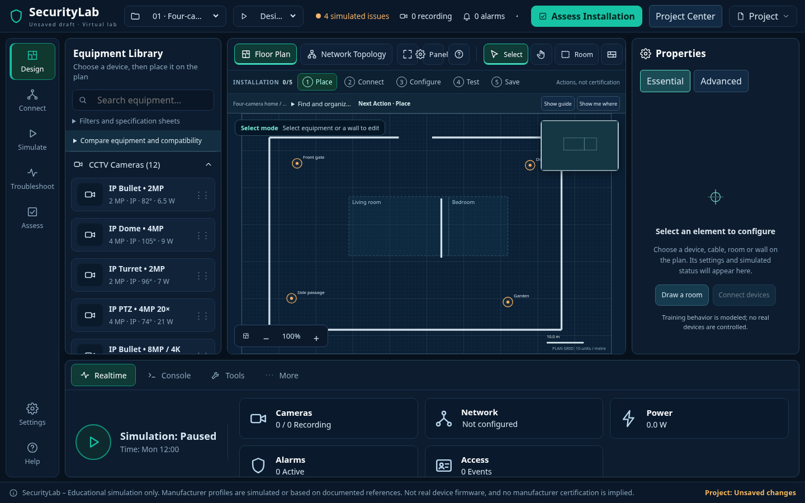
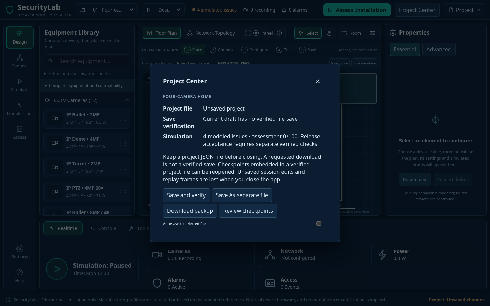
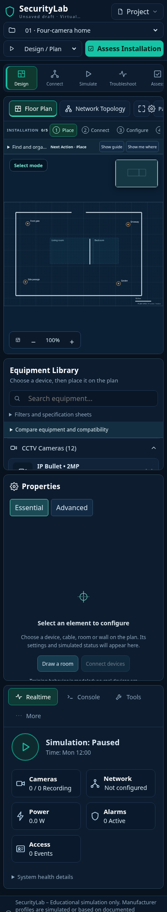

# SecurityLab: ten UI/UX enhancements

Implemented against main `43502d722ff8324a0a8511ff89687530a9e507a0` on branch `feat/task-workspace-ux`.

## Implementation

| # | Enhancement | Delivered behavior | Main implementation |
|---|---|---|---|
| 1 | Task-based workspace | Design, Connect, Simulate, Troubleshoot and Assess select relevant editing tools and dock tabs. Existing engineering tools remain accessible in their activities. | `frontend-react/src/workspace/activities.ts`, `NavRail`, `Dock`, `Canvas` |
| 2 | Contextual instructor | Next action derives from scenario equipment requirements and current simulated findings. Show me where reveals and highlights controls without installing, configuring or repairing equipment. | `LearningGuide`, `SecurityLab` |
| 3 | Equipment comparison | Compare any two profiles, including scenario-excluded and reference-only equipment. Shows Ethernet/PoE interfaces, power and PoE ratings, protocols, signal, placement eligibility and explanations. | `EquipmentCompare`, `Catalog` |
| 4 | Canvas navigation | Search components across floors; locate devices, cables, rooms, walls, targets and markers. Floor breadcrumbs, a minimap, session hide/isolate and canvas movement locks support navigation. Locate unhides the component and opens its inspector. | `SceneNavigator`, `Canvas`, `useWorkbench` |
| 5 | Connection review | Proposed cables are simulated before installation. Preview shows route, estimated length (including floor rise), virtual ports, VLANs, PoE and live modeled faults. Cancel creates no cable. Confirmation rejects a stale preview if the model changed. | `ConnectionPreview`, `ConnectionGuide`, `useWorkbench` |
| 6 | Safer inspector | Essential/Advanced detail levels. Numeric drafts in geometry, CCTV, network, alarm, access and power configuration use validation and Apply/Cancel; blank values never silently become zero. | `SafeNumber`, `Inspector`, configuration panels |
| 7 | Guided repair | Inspect centers the affected component and highlights related physical links and available simulated network trace links. A watched check remains available to rerun after its original finding disappears following repair. | `GuidedDiagnostics`, `Canvas` |
| 8 | Timeline and replay | Chronological simulation and access events, type filtering and component links. Last 40 committed model transitions support play/pause/step and read-only comparisons of before/after power, camera, recording and fault evidence. | `EventTimeline`, `useWorkbench` |
| 9 | Assessment feedback | Failed criteria expose corrective tasks and links to relevant current components. Original seeded challenge components are prioritized. Historical evidence is preserved; independent and guided-practice trend series are separated. | `AssessmentActions`, `AssessmentConsole` |
| 10 | Project Center | Save/read-back status, Save As, backups, checkpoints, autosave and conflict recovery in one accessible dialog. Application discard/rename/PIN/template prompts use focus-contained dialogs. Status chips report modeled issues rather than a blanket readiness claim. | `ProjectCenter`, `Dialogs`, `useWorkbench`, `TopBar` |

## Verification

Run commands from `SecurityLab/frontend-react`:

```sh
npm run check
npm test
npm run build
npx playwright test --project=chromium --workers=3 --timeout=30000
```

- TypeScript: passed.
- Unit tests: 172/172 passed across 15 test files.
- Production build and offline precache generation: passed.
- Chromium browser suite: 89/89 passed, including 13 new workspace tests.
- Browser coverage includes all fifteen scenarios and console tabs, desktop/tablet/mobile layouts, touch interactions, canvas navigation, occupied Ethernet ports, connection cancel/confirm, stale-preview rejection, autosave suspension during discard confirmation, blank numeric drafts, multi-floor/hidden-component backup integrity, assessment links, custom discard dialogs, keyboard focus, file checksums and conflicts, interrupted writes, offline cold relaunch and multi-tab PWA update races.
- Axe checks found no serious/critical violations in the workstation, every console tab, the selected inspector with a blank numeric draft, or Project Center.
- Existing troubleshooting repair test now also checks that the selected check can be rerun after the original fault has cleared.
- Large-layout browser test passed with 40 devices and 60 walls: render, drag and undo; this is an automated Linux browser check, not physical Windows acceptance.

## Behavior and acceptance boundaries

- Numeric fields stage changes until Apply; text fields and checkboxes retain immediate editing behavior.
- Hide/isolate/locks are session canvas controls, not electrical isolation or removal from simulation/assessment. Other-floor and hidden components remain in saved files.
- Replay frames are session-only and bounded to 40 committed transitions. They are not embedded in project JSON. Existing simulation/access journals remain saved project evidence.
- Recovered forks, restored checkpoints and imported copies retain unsaved-work/discard protection until a verified save; only untouched new scenarios and worked examples receive starter-project treatment.
- A faulty but structurally compatible connection may be installed deliberately for training. Preview evidence is simulated, not a hardware compatibility certificate.
- Historical assessment links inspect the current model; they do not alter the recorded score or fingerprint. Assistance labels come from each report's independence gate; older records are labeled legacy when that evidence is absent.
- Save/read-back verification is available with supported writable file handles. Download fallback remains explicitly unverified. The real browser/OS file picker and browser-controlled leave-page protection remain native; application `window.confirm` and `window.prompt` calls have been removed.
- Firefox/WebKit and physical Windows/Android acceptance were not run in this change. No claim of a production release or physical-device acceptance is made.
- The production build reports a large-entry-chunk warning (approximately 775 kB minified).

## Review captures

Actual local production-build screenshots, not mockups:






